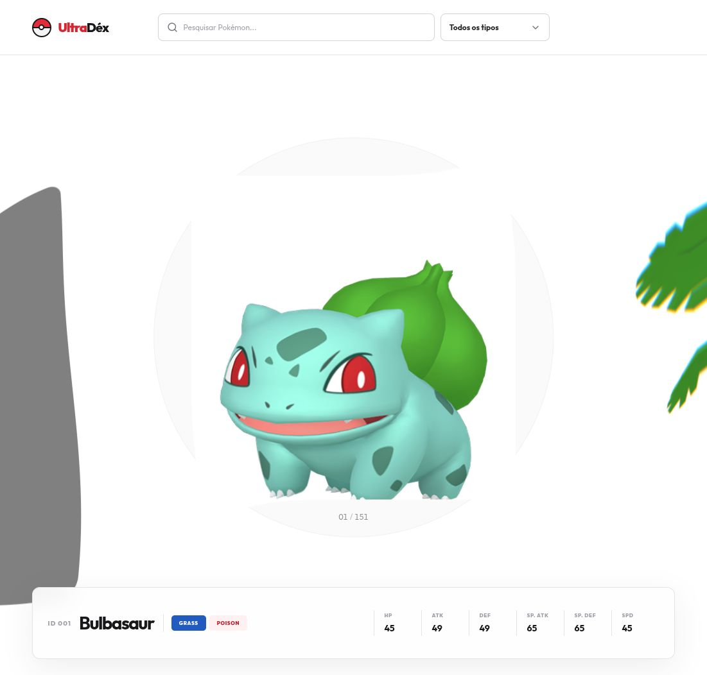
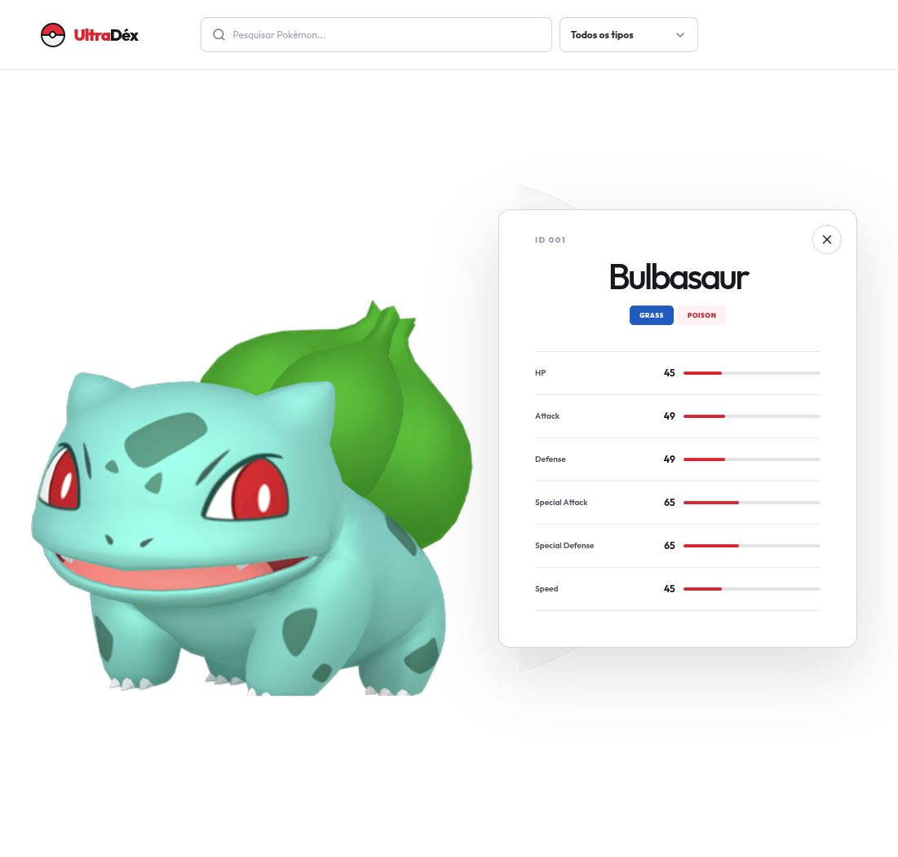

# UltraDéx

Uma Pokédex interativa da primeira geração, construída com React, TypeScript e WebGL. O projeto reúne os 151 Pokémon de Kanto em um carrossel 3D, com pesquisa, filtro por tipo e um painel de detalhes com os atributos de cada Pokémon.

## Demonstração

### Tela inicial

O Pokémon ativo aparece no centro do carrossel e seus tipos e atributos resumidos são exibidos na barra inferior, sem abrir o painel de detalhes.



### Pokémon selecionado

Ao selecionar um Pokémon, a interface destaca sua imagem e abre o painel com ID, tipos, valores e barras visuais de atributos.



## Funcionalidades

- Catálogo completo dos 151 Pokémon da primeira geração.
- Carrossel circular renderizado em WebGL, com efeito de lente e distorção líquida.
- Navegação por arraste, roda do mouse e teclado.
- Atalhos de teclado com setas, `Home`, `End`, `Enter` e `Escape`.
- Pesquisa instantânea por nome ou número da Pokédex, com ou sem `#`.
- Filtro por tipo, combinado com o texto pesquisado.
- Contador da posição atual no catálogo filtrado.
- Resumo do Pokémon ativo com ID, tipos e seis atributos.
- Painel de detalhes com HP, ataque, defesa, ataque especial, defesa especial e velocidade.
- Estado vazio com ação para limpar os filtros.
- Layout responsivo para desktop, tablet e celular.
- Respeito à preferência de redução de movimento do sistema.
- Rótulos ARIA, foco visível e controles acessíveis por teclado.

## Dados e APIs

O projeto não faz requisições a uma API REST para obter os dados dos Pokémon durante a execução. Nomes, IDs, tipos e atributos ficam versionados localmente em [`src/data/pokedex-data.json`](src/data/pokedex-data.json), o que torna a filtragem imediata e mantém o catálogo disponível sem depender de uma API de dados.

As imagens são carregadas sob demanda do repositório público de sprites da PokeAPI:

```text
https://raw.githubusercontent.com/PokeAPI/sprites/master/sprites/pokemon/other/home/{id}.png
```

| Fonte | Uso no projeto |
| --- | --- |
| [PokeAPI Sprites](https://github.com/PokeAPI/sprites) | Artes oficiais dos Pokémon na variante `other/home` |
| `pokedex-data.json` | Base local dos 151 Pokémon, tipos e atributos |

> O `FlexCarousel` possui imagens demonstrativas do Unsplash como fallback interno, mas elas não são usadas na tela da Pokédex, pois o catálogo sempre fornece os sprites da PokeAPI.

## Tecnologias e bibliotecas

### Em uso na aplicação

| Tecnologia | Finalidade |
| --- | --- |
| [React 19](https://react.dev/) e [React DOM](https://react.dev/reference/react-dom) | Componentes, estado, efeitos e renderização da SPA |
| [TypeScript 6](https://www.typescriptlang.org/) | Tipagem estática e inferência dos modelos a partir do JSON |
| [Vite 8](https://vite.dev/) | Servidor de desenvolvimento e build de produção |
| [TanStack Router](https://tanstack.com/router) | Roteamento tipado baseado em arquivos e geração da árvore de rotas |
| [TanStack Query](https://tanstack.com/query) | `QueryClientProvider` preparado na raiz da aplicação |
| [Tailwind CSS 4](https://tailwindcss.com/) | Estilos utilitários e responsividade |
| [OGL](https://github.com/oframe/ogl) | Renderização WebGL do carrossel, texturas, shaders e pós-processamento |
| [Lucide React](https://lucide.dev/) | Ícones de pesquisa, seleção e fechamento |
| [Fontsource Outfit Variable](https://fontsource.org/fonts/outfit) | Fonte variável principal da interface |
| [tw-animate-css](https://github.com/Wombosvideo/tw-animate-css) | Utilitários de animação integrados ao Tailwind |

### Ferramentas de desenvolvimento e configuração

| Pacote | Finalidade |
| --- | --- |
| `@vitejs/plugin-react` | Integração entre React e Vite |
| `@tailwindcss/vite` | Compilação do Tailwind pelo Vite |
| `@tanstack/router-plugin` e `@tanstack/router-cli` | Geração automática e code splitting das rotas |
| `@tanstack/devtools-vite` | Devtools durante o desenvolvimento |
| `@types/node`, `@types/react` e `@types/react-dom` | Tipos usados pelo TypeScript |

O manifesto também mantém `@base-ui/react`, `class-variance-authority`, `cn`, `shadcn`, `@fontsource-variable/inter`, `@tanstack/react-devtools` e `@tanstack/react-router-devtools`. Eles fazem parte do scaffold/toolkit do projeto, mas não são importados diretamente pelos componentes atuais.

## Como executar

### Pré-requisitos

- Node.js em uma versão compatível com o Vite 8.
- [pnpm](https://pnpm.io/) instalado.

### Instalação

```bash
git clone <URL_DO_REPOSITORIO>
cd pokedex
pnpm install
```

### Desenvolvimento

```bash
pnpm dev
```

A aplicação será iniciada em [http://localhost:3000](http://localhost:3000). Se a porta estiver ocupada, o Vite escolherá automaticamente a próxima disponível.

### Build de produção

```bash
pnpm build
```

### Pré-visualização do build

```bash
pnpm preview
```

## Scripts

| Comando | Descrição |
| --- | --- |
| `pnpm dev` | Inicia o servidor de desenvolvimento |
| `pnpm build` | Gera o build otimizado de produção |
| `pnpm preview` | Serve localmente o build de produção |
| `pnpm generate-routes` | Regenera a árvore tipada do TanStack Router |

## Estrutura principal

```text
src/
├── components/
│   ├── FlexCarousel.tsx          # Motor WebGL e interações do carrossel
│   └── pokedex/
│       ├── ActivePokemon.tsx     # Resumo do Pokémon ativo
│       ├── CarouselEmptyState.tsx
│       ├── DetailPanel.tsx       # Painel/modal de atributos
│       ├── PokedexHeader.tsx     # Busca e filtro por tipo
│       ├── TypeBadges.tsx
│       └── pokemon.ts            # Tipos, atributos e URL dos sprites
├── data/
│   └── pokedex-data.json         # Dados locais dos 151 Pokémon
├── routes/
│   ├── __root.tsx                # Layout raiz e QueryClient
│   └── index.tsx                 # Composição e estado da página inicial
├── main.tsx
└── styles.css
```

## Como a interface funciona

1. A página carrega o catálogo local e monta a lista de tipos disponíveis.
2. A busca e o filtro derivam uma lista de Pokémon com `useMemo`.
3. O `FlexCarousel` transforma essa lista em texturas WebGL e mantém o item central como ativo.
4. Um clique ou `Enter` seleciona o item e abre o painel de detalhes.
5. Alterar a busca ou o tipo fecha os detalhes e reposiciona o catálogo no primeiro resultado.

## Créditos

Pokémon e os nomes dos personagens pertencem à Nintendo, Game Freak e The Pokémon Company. Este é um projeto demonstrativo, sem vínculo oficial com essas empresas.
