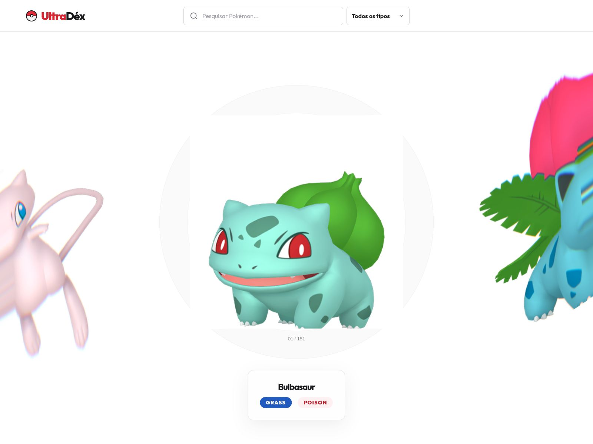
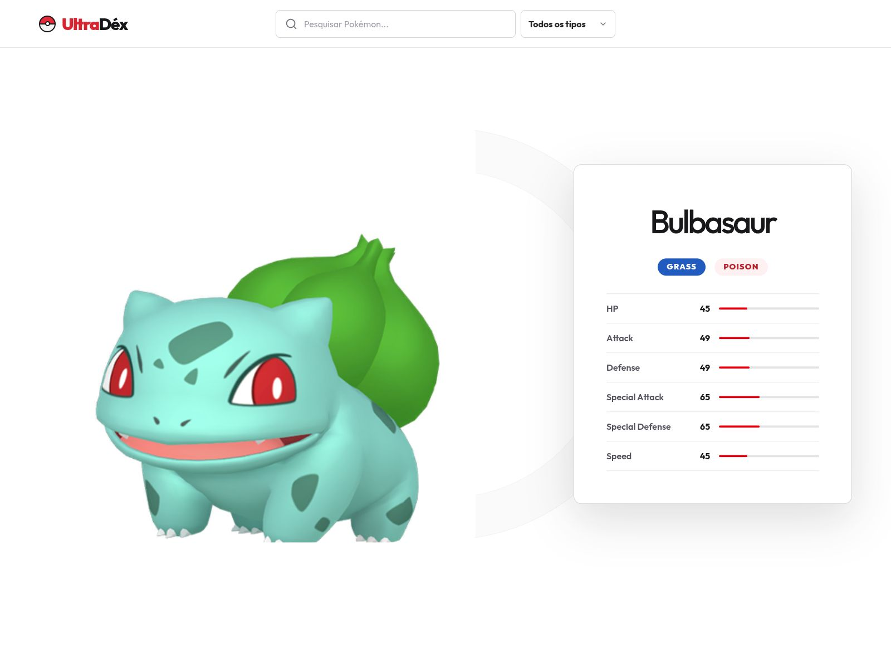

# UltraDéx

Uma Pokédex interativa fullstack da primeira geração, construída com React, TypeScript e WebGL no frontend e Spring Boot com MongoDB no backend. O projeto reúne os Pokémon de Kanto em um carrossel 3D de alta fidelidade visual, com pesquisa em tempo real, filtro dinâmico por tipo, painel de detalhes com atributos completos e uma API RESTful para consulta e gerenciamento dos dados.

## Demonstração

### Tela inicial

O Pokémon ativo aparece no centro do carrossel com efeito de lente líquida, e seu nome e tipos são exibidos em destaque na barra inferior.



### Pokémon selecionado

Ao selecionar um Pokémon pelo clique ou teclado, a interface destaca sua arte oficial e abre o painel lateral com ID, tipos, valores numéricos e barras visuais de atributos, além de botão para fechar.



## Funcionalidades

### Frontend e Interface
- Catálogo dos Pokémon da primeira geração integrados em tempo real com a API.
- Carrossel circular renderizado em WebGL com a biblioteca OGL, com efeito de lente e distorção líquida (*liquid lens*).
- Navegação fluida por arraste (*drag*), roda do mouse (*scroll*) e teclado.
- Atalhos de teclado com setas direcionais, `Home`, `End`, `Enter` e `Escape`.
- Pesquisa instantânea por nome ou número/ID da Pokédex, com ou sem `#`.
- Filtro por tipo derivado dinamicamente do catálogo, combinável com a busca textual.
- Contador da quantidade de resultados em relação ao total de Pokémon cadastrados.
- Card flutuante do Pokémon ativo com nome e insígnias (*badges*) de tipo.
- Painel de detalhes com HP, ataque, defesa, ataque especial, defesa especial, velocidade e botão de fechamento.
- Tratamento de estados assíncronos: indicador de carregamento (*loading*) e tela de erro com botão para tentar novamente.
- Estado vazio com ação rápida para limpar os filtros aplicados.
- Layout responsivo adaptado para desktop, tablet e dispositivos móveis.
- Respeito automático às preferências de redução de movimento do sistema operacional (`prefers-reduced-motion`).
- Acessibilidade com rótulos ARIA, regiões de anúncio de acessibilidade (*live regions*) e foco visível.

### Backend e API REST
- API RESTful estruturada em camadas com Spring Boot (Controller, Service, Repository, DTO e Model).
- Persistência NoSQL com MongoDB via Spring Data MongoDB, utilizando coleções para `Pokemon` e `Types`.
- Relacionamento de tipos com anotação `@DBRef` para integridade e reuso das entidades de tipo.
- Operações de CRUD completas para Pokémon: listagem geral, cadastro unitário, cadastro em lote (*batch*), atualização (`PUT`) e remoção (`DELETE`).
- Consulta de tipos de Pokémon (`/pokemon-type`) com busca por nome.
- Suporte a CORS configurado para permitir a comunicação com a interface local (`http://localhost:3000`).
- Documentação interativa e console de testes via Swagger UI / OpenAPI (SpringDoc).
- Cobertura de testes unitários e de contrato JSON com JUnit 5 e Mockito.
- Scripts e massa de dados em JSON (`backend/data/pokemon-batch.json`) para carga e povoamento inicial da base.

## Arquitetura e Dados

A aplicação adota uma arquitetura cliente-servidor desacoplada:

1. **Frontend**: Uma Single Page Application (SPA) em React que consome os dados assincronamente da API REST por meio de `fetchPokemons` em [`frontend/src/lib/pokemon-api.ts`](frontend/src/lib/pokemon-api.ts). O endpoint padrão é `http://localhost:8080/pokemon` (customizável pela variável de ambiente `VITE_API_URL`).
2. **Backend**: Serviço REST em Spring Boot que encapsula a lógica de negócio e persistência no MongoDB, retornando dados estruturados com nome, atributos de combate, imagem e tipos associados.
3. **Imagens e Sprites**: As artes oficiais continuam sendo servidas diretamente do repositório público de sprites da PokeAPI (variante `other/home`), garantindo imagens em alta resolução sem sobrecarregar o banco de dados:

```text
https://raw.githubusercontent.com/PokeAPI/sprites/master/sprites/pokemon/other/home/{id}.png
```

| Fonte / Recurso | Uso no projeto |
| --- | --- |
| [PokeAPI Sprites](https://github.com/PokeAPI/sprites) | Sprites oficiais em alta resolução na variante `other/home` |
| MongoDB (`pokedex_db`) | Banco de dados NoSQL com as coleções `Pokemon` e `Types` |
| `backend/data/pokemon-batch.json` | Carga inicial com os 151 Pokémon da 1ª geração formatados para a rota de batch |
| `Script_Pokedex.sql` | Script SQL relacional alternativo com esquema e dados dos Pokémon e treinadores |

## Endpoints da API

A API disponibiliza os seguintes endpoints REST principais:

| Método | Rota | Descrição |
| --- | --- | --- |
| `GET` | `/pokemon` | Retorna todos os Pokémon cadastrados com atributos e tipos |
| `POST` | `/pokemon` | Cadastra um novo Pokémon individualmente |
| `POST` | `/pokemon/create-batch` | Cadastra múltiplos Pokémon em lote |
| `PUT` | `/pokemon/{id}` | Atualiza os dados de um Pokémon existente pelo seu ID |
| `DELETE` | `/pokemon/{id}` | Exclui um Pokémon existente pelo seu ID |
| `GET` | `/pokemon-type` | Lista todos os tipos de Pokémon cadastrados |
| `GET` | `/pokemon-type/name/:name?name={nome}` | Retorna os detalhes de um tipo a partir do nome informado |

A documentação interativa com Swagger UI está acessível na rota `/docs` (ou `/swagger-ui/index.html`) quando a API estiver em execução.

## Tecnologias e bibliotecas

### Frontend

| Tecnologia | Finalidade |
| --- | --- |
| [React 19](https://react.dev/) e [React DOM](https://react.dev/reference/react-dom) | Componentes, estado, efeitos e renderização da SPA |
| [TypeScript 6](https://www.typescriptlang.org/) | Tipagem estática e interfaces dos modelos de domínio |
| [Vite 8](https://vite.dev/) | Servidor de desenvolvimento rápido e empacotamento de produção |
| [TanStack Router](https://tanstack.com/router) | Roteamento tipado baseado em arquivos e árvore de rotas |
| [TanStack Query](https://tanstack.com/query) | `QueryClientProvider` configurado na raiz da aplicação |
| [Tailwind CSS 4](https://tailwindcss.com/) | Estilização utilitária de alta performance e design responsivo |
| [OGL](https://github.com/oframe/ogl) | Biblioteca WebGL minimalista para shaders, texturas e carrossel 3D |
| [Lucide React](https://lucide.dev/) | Ícones de pesquisa, seleção, fechamento e navegação |
| [Fontsource Outfit Variable](https://fontsource.org/fonts/outfit) | Tipografia variável moderna da interface |
| [tw-animate-css](https://github.com/Wombosvideo/tw-animate-css) | Utilitários de animação CSS integrados ao Tailwind |

### Backend

| Tecnologia | Finalidade |
| --- | --- |
| [Java 25](https://openjdk.org/) | Linguagem de programação utilizada no desenvolvimento da API |
| [Spring Boot 4.2.0](https://spring.io/projects/spring-boot) | Framework base para a aplicação backend e injeção de dependências |
| [Spring Web MVC](https://docs.spring.io/spring-boot/reference/web/servlet.html) | Exposição de endpoints RESTful e tratamento de requisições HTTP |
| [Spring Data MongoDB](https://spring.io/projects/spring-data-mongodb) | Abstração de repositórios e mapeamento objeto-documento para MongoDB |
| [SpringDoc OpenAPI 3.1.0](https://springdoc.org/) | Geração automática da documentação OpenAPI 3 e interface Swagger UI |
| [MongoDB](https://www.mongodb.com/) | Banco de dados NoSQL orientado a documentos |
| [Maven](https://maven.apache.org/) | Gerenciador de dependências e build do projeto backend (com `./mvnw`) |

### Ferramentas de desenvolvimento e testes

| Pacote / Ferramenta | Finalidade |
| --- | --- |
| `@vitejs/plugin-react` | Plugin de integração entre React e o bundler Vite |
| `@tailwindcss/vite` | Plugin de compilação do Tailwind CSS via Vite |
| `@tanstack/router-plugin` e `@tanstack/router-cli` | Geração automática e divisão de código das rotas |
| `@tanstack/devtools-vite` | Painel de ferramentas de desenvolvimento durante a execução local |
| `JUnit 5` e `Mockito` | Testes unitários para regras de serviço e validação de contratos JSON |
| Node.js scripts | Script utilitário em ESM (`export-pokemon-batch.mjs`) para extração e carga de dados |

## Como executar

### Pré-requisitos

- [Node.js](https://nodejs.org/) (versão compatível com Vite 8).
- [pnpm](https://pnpm.io/) instalado globalmente.
- [Java Development Kit (JDK) 25](https://jdk.java.net/) configurado no ambiente.
- Instância do [MongoDB](https://www.mongodb.com/) em execução (localmente ou via MongoDB Atlas).

---

### 1. Configuração e execução do Backend

1. Acesse o diretório do backend:
   ```bash
   cd backend
   ```

2. Crie o arquivo `application.properties` em `src/main/resources/` a partir do modelo de exemplo:
   ```bash
   cp src/main/resources/application.properties.example src/main/resources/application.properties
   ```

3. Configure as credenciais de conexão ao MongoDB no arquivo `src/main/resources/application.properties`:
   ```properties
   spring.application.name=PokedexAPI
   springdoc.swagger-ui.path=/docs
   spring.mongodb.uri=mongodb+srv://<usuario>:<senha>@<cluster>.mongodb.net/
   spring.mongodb.database=pokedex_db
   ```
   > Se estiver utilizando uma instância local padrão do MongoDB, configure:
   > `spring.mongodb.uri=mongodb://localhost:27017/pokedex_db`

4. Execute a aplicação backend:
   ```bash
   ./mvnw spring-boot:run
   ```
   A API iniciará por padrão em [http://localhost:8080](http://localhost:8080).
   A documentação Swagger estará disponível em [http://localhost:8080/docs](http://localhost:8080/docs) (ou [http://localhost:8080/swagger-ui/index.html](http://localhost:8080/swagger-ui/index.html)).

5. *(Opcional)* Povoamento inicial da base de dados:
   Você pode realizar uma requisição `POST` para `http://localhost:8080/pokemon/create-batch` enviando o conteúdo do arquivo [`backend/data/pokemon-batch.json`](backend/data/pokemon-batch.json) no corpo da requisição para cadastrar todos os 151 Pokémon com seus respectivos tipos e atributos.

---

### 2. Configuração e execução do Frontend

1. Em um novo terminal, acesse o diretório do frontend:
   ```bash
   cd frontend
   ```

2. Instale as dependências:
   ```bash
   pnpm install
   ```

3. *(Opcional)* Caso a API esteja em uma porta ou endereço diferente, crie um arquivo `.env` com a variável:
   ```env
   VITE_API_URL=http://localhost:8080
   ```

4. Inicie o servidor de desenvolvimento:
   ```bash
   pnpm dev
   ```

A interface web será iniciada em [http://localhost:3000](http://localhost:3000).

---

## Scripts

### Frontend (`frontend/`)

| Comando | Descrição |
| --- | --- |
| `pnpm dev` | Inicia o servidor Vite de desenvolvimento em `localhost:3000` |
| `pnpm build` | Gera o build de produção tipado e minificado em `dist/` |
| `pnpm preview` | Executa um servidor local servindo os arquivos do build |
| `pnpm generate-routes` | Regenera a árvore de rotas tipadas do TanStack Router |

### Backend (`backend/`)

| Comando | Descrição |
| --- | --- |
| `./mvnw spring-boot:run` | Inicia o servidor da API Spring Boot |
| `./mvnw clean test` | Executa a suíte de testes unitários e testes de contrato com JUnit e Mockito |
| `./mvnw clean package` | Compila o projeto e gera o arquivo `.jar` executável em `target/` |
| `node scripts/export-pokemon-batch.mjs` | Executa o script gerador do arquivo `pokemon-batch.json` |

## Estrutura principal

```text
pokedex/
├── backend/
│   ├── src/
│   │   ├── main/
│   │   │   ├── java/com/emanuelphillipe/PokedexAPI/
│   │   │   │   ├── configuration/          # Configurações de CORS e documentação OpenAPI
│   │   │   │   ├── controller/             # Controllers REST (/pokemon e /pokemon-type)
│   │   │   │   ├── dto/                    # Records DTO para requisições unitárias e em lote
│   │   │   │   ├── model/                  # Entidades/Documentos MongoDB (Pokemon, PokemonType)
│   │   │   │   ├── repository/             # Interfaces Spring Data MongoDB
│   │   │   │   ├── service/                # Camada de regras de negócio e persistência
│   │   │   │   └── PokedexApiApplication.java
│   │   │   └── resources/
│   │   │       └── application.properties.example # Modelo de configuração da aplicação
│   │   └── test/                           # Testes unitários de serviço e contratos JSON
│   ├── data/
│   │   └── pokemon-batch.json              # Payload de 151 Pokémon pronto para inserção em lote
│   ├── scripts/
│   │   └── export-pokemon-batch.mjs        # Utilitário para geração da massa de dados
│   ├── mvnw / mvnw.cmd                     # Wrapper Maven
│   └── pom.xml                             # Gerenciador de dependências e plugins Maven
├── frontend/
│   ├── src/
│   │   ├── components/
│   │   │   ├── FlexCarousel.tsx            # Motor WebGL com shaders e distorção líquida
│   │   │   └── pokedex/
│   │   │       ├── ActivePokemon.tsx       # Card flutuante com nome e tipos do Pokémon ativo
│   │   │       ├── CarouselEmptyState.tsx  # Estado exibido quando a busca não retorna resultados
│   │   │       ├── DetailPanel.tsx         # Modal com estatísticas de combate e botão de fechar
│   │   │       ├── PokedexHeader.tsx       # Barra superior com busca, filtro e contador
│   │   │       ├── TypeBadges.tsx          # Componente de insígnias visuais dos tipos
│   │   │       └── pokemon.ts              # Interfaces TypeScript e definições de estatísticas
│   │   ├── lib/
│   │   │   ├── pokemon-api.ts              # Cliente HTTP para integração com a API REST
│   │   │   └── utils.ts                    # Utilitários de composição de classes CSS
│   │   ├── routes/
│   │   │   ├── __root.tsx                  # Layout raiz com QueryClientProvider
│   │   │   └── index.tsx                   # Página principal, controle de filtros e estados
│   │   ├── main.tsx                        # Ponto de entrada da aplicação React
│   │   └── styles.css                      # Configurações e utilitários globais do Tailwind
│   ├── package.json                        # Dependências e scripts do frontend
│   └── vite.config.ts                      # Configuração do Vite e plugins
├── docs/
│   └── screenshots/                        # Imagens demonstrativas do README
├── Script_Pokedex.sql                      # Esquema e dados SQL relacionais alternativos
└── README.md
```

## Como a aplicação funciona

1. **Disponibilização dos dados**: O backend inicializa a API REST conectada ao MongoDB, expondo os dados dos Pokémon e seus tipos através de endpoints HTTP.
2. **Consumo assíncrono**: Ao abrir o frontend, o hook `useEffect` dispara a requisição `fetchPokemons()` para a API (`/pokemon`), com suporte a cancelamento de requisição via `AbortController`.
3. **Estados da interface**:
   - Enquanto a requisição está em andamento, a aplicação exibe uma mensagem indicativa de carregamento (*Loading*).
   - Caso ocorra falha de rede ou indisponibilidade da API, é apresentado um estado amigável de erro (*ErrorState*) com a opção de tentar novamente.
4. **Extração de tipos e filtragem**: Assim que a lista é carregada com sucesso, os tipos únicos presentes nos Pokémon são extraídos automaticamente para compor as opções do seletor. Os filtros de texto e tipo recalculam a lista exibida instantaneamente via `useMemo`.
5. **Renderização 3D WebGL**: A lista filtrada é fornecida ao `FlexCarousel`, que projeta as imagens dos Pokémon como texturas em malhas renderizadas com OGL, aplicando deformações visuais com base na interação do usuário.
6. **Inspeção de detalhes**: O Pokémon central do carrossel é mantido como o Pokémon ativo. Ao clicar no card ou pressionar `Enter`, o painel lateral é aberto com as estatísticas completas de combate (HP, Attack, Defense, Special Attack, Special Defense e Speed).
7. **Responsividade aos filtros**: Qualquer alteração na pesquisa textual ou no seletor de tipos fecha automaticamente o painel de detalhes e reposiciona o carrossel no primeiro resultado correspondente.

## Créditos

Pokémon e os nomes dos personagens pertencem à Nintendo, Game Freak e The Pokémon Company. Este é um projeto demonstrativo e educacional, sem vínculo oficial com essas empresas.
